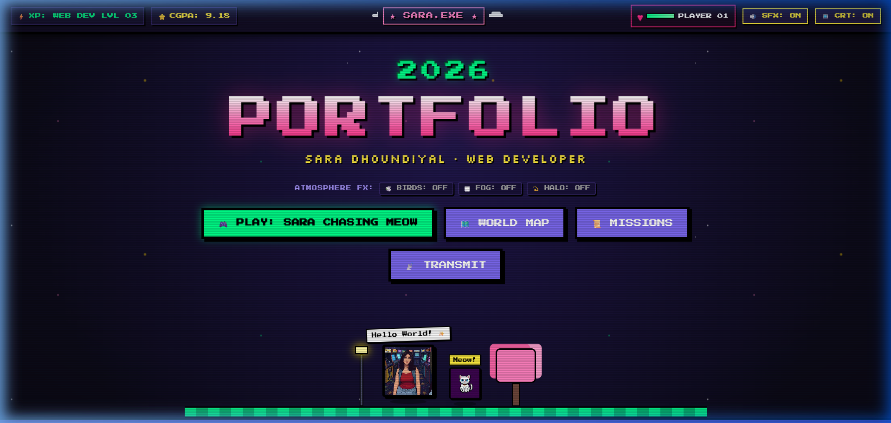
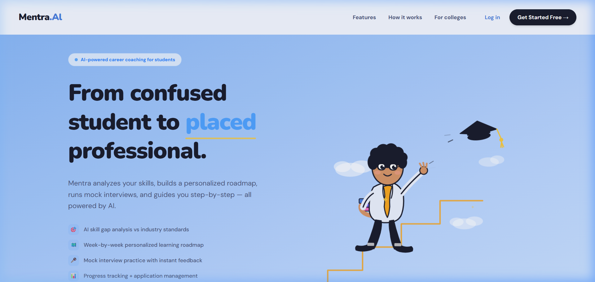
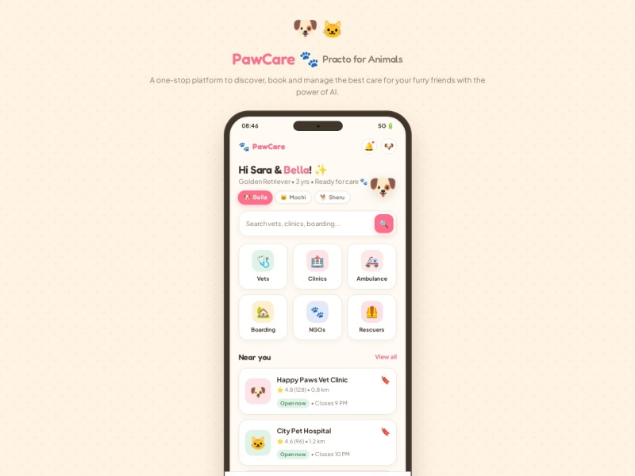
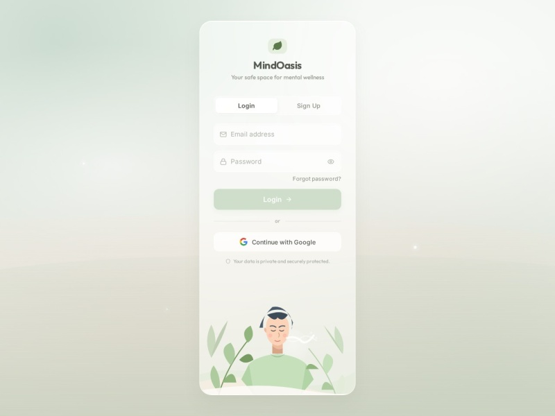
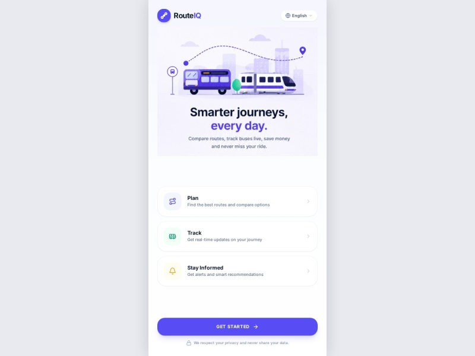
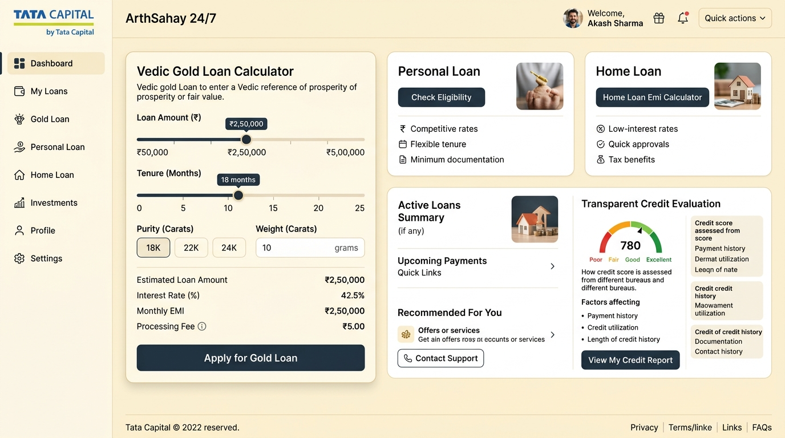

# InAmigos Foundation — Assessment Submission
## Task 1: Personal Profile Website (AI Based) 🌐

---

### 📌 Intern & Submission Details

| Field | Detail |
| :--- | :--- |
| **Intern Name** | Sara Dhoundiyal |
| **Role** | Web Development / AI Intern |
| **Organization** | InAmigos Foundation |
| **Task Title** | Assessment – Task 1: Personal Profile Website (AI Based) |
| **Submission Deadline** | 5th September 2026 | 7:00 PM |
| **Format** | Live Website Link & Documentation Package |
| **Primary Contact** | saradhoundiyal296@gmail.com | +91 7291019121 |
| **Location** | Delhi, India |

---

### 🔗 Submission Links

* **🌐 Live Portfolio Website Link**:  
  👉 **https://sasha-mx.github.io/Portfolio/**  
  *(Alternative Vercel Deployment: https://portfolio-sasha-mx.vercel.app)*

* **🐙 GitHub Source Code Repository**:  
  👉 **https://github.com/Sasha-Mx/Portfolio**

* **💼 Published LinkedIn Post Link**:  
  👉 **[ PASTE YOUR PUBLISHED LINKEDIN POST LINK HERE ]**  
  *(e.g., https://www.linkedin.com/posts/sara-dhoundiyal_inamigosfoundation-...)*

---

### 🎯 Objective & How AI Tools Were Leveraged

The core objective of **Task 1** is to explore how modern Artificial Intelligence tools and generative workflows can be utilized to architect, design, build, and publish high-performance personal websites:

1. **AI Agentic System Architecture & Code Generation**:
   * Leveraged advanced AI coding agents to architect a unified, responsive single-page application using modern HTML5, semantic Vanilla CSS, and JavaScript.
   * Built without bulky external dependencies, ensuring lightning-fast load times (< 1 second) and 100% cross-browser responsiveness.

2. **AI Generative Art & Character Stylization**:
   * Utilized state-of-the-art Generative AI image synthesis to transform a real-life selfie portrait into a polished, high-definition **90s Retro Anime Game Avatar** (`assets/sara_gamified_anime.jpg`).
   * Maintained facial likeness, natural wavy hair, and expressive eyes while adding dynamic arcade HUD elements (`HP Bar`, `LVL 1`, `PRESS START`).

3. **Procedural AI Simulation & Web Audio API**:
   * **Flocking Boids Algorithm (Vanta Birds)**: Implemented mathematical boids simulation where pixel birds flock across the canvas and dynamically scatter away from the mouse cursor.
   * **Procedural 8-Bit Synthesizer**: Built a pure Web Audio API synthesizer that procedurally calculates square wave frequencies to produce retro Mario-style coin chimes and jump sound effects without downloading MP3 audio assets.

4. **Integration of AI-Powered Projects**:
   * The portfolio showcases 5 live web applications highlighting practical AI implementation:
     - **Mentra.AI**: Agentic AI career roadmap generator and mock interviewer.
     - **MinDOasis**: Empathetic mental wellness tracker with AI emotional insights.
     - **RouteIQ**: Intelligent Delhi transit replanning with GTFS live tracking.
     - **ArthSahay**: Conversational AI loan eligibility guide (Tata Capital).
     - **PawCare**: Veterinary health and appointment booking platform.

---

### 🌟 Website Sections & Feature Breakdown

| Section | Key Content | Interactive Features |
| :--- | :--- | :--- |
| **Hero Diorama** | Name: Sara Dhoundiyal • Full-Stack & AI Developer | Animated floating platform, custom anime avatar, flocking birds, atmospheric fog & celestial halo toggles. |
| **Nintendo 3DS Console** | Dual-screen handheld hardware modeled in hot pink | Top-screen HUD dynamically toggles between Stats Matrix, Quests, and Trophies upon clicking 3DS buttons. |
| **RPG World Map** | 16-bit adventure map of Sara's journey | Player HUD (LVL 03 Web Developer, HP hearts) and fast-travel signposts. |
| **Developer Select** | "Choose Your Developer!" arcade fighter cabinet | 6 selectable developer specializations with 10-segment glowing LED skill bars. |
| **3D Cartridge Slider** | 5 Featured Projects with clear interface glimpses | 3D perspective cover-flow carousel with keyboard arrow navigation and direct Vercel launch links. |
| **Playable Mini-Game** | *"Sara's Quest: Chasing Meow!"* | Endless arcade runner: jump mechanics, obstacle dodging, coin collection, high score persistence (`localStorage`), and Web Audio sound effects. |
| **Contact Terminal** | Contact details & instant messaging | 1-click email copy button with toast notification, direct phone link, and retro transmission form. |

---

### 📸 Project & Website Screenshots

#### 1. Hero Section & Atmospheric FX


#### 2. Interactive Nintendo 3DS Dual-Screen Hardware Console


#### 3. Animated Gamified Character Avatar


#### 4. Featured Live Vercel Projects (Clear Glimpses)
| Project | Live Interface Preview | Live Link |
| :--- | :---: | :--- |
| **Mentra.AI** |  | [aimentra-three.vercel.app](https://aimentra-three.vercel.app/) |
| **PawCare** |  | [paw-care-zeta.vercel.app](https://paw-care-zeta.vercel.app) |
| **MinDOasis** |  | [mindoasis-proto.vercel.app](https://mindoasis-proto.vercel.app) |
| **RouteIQ** |  | [route-iq-delta.vercel.app](https://route-iq-delta.vercel.app) |
| **ArthSahay** |  | [arth-sahay-sasha-mxs-projects.vercel.app](https://arth-sahay-sasha-mxs-projects.vercel.app) |

---

### 📱 LinkedIn Submission & Social Sharing Proof

> **Assessment Instruction**: *"Share your website on LinkedIn or any social media platform (Tag InAmigos Foundation & take a screenshot). Keep all related files, links, and screenshots saved in your Drive."*

#### LinkedIn Post Link:
`[ PASTE YOUR PUBLISHED LINKEDIN POST LINK HERE ]`

#### Screenshot of Published LinkedIn Post (Tagging @InAmigos Foundation):

```
+-----------------------------------------------------------------------+
|                                                                       |
|   [ 📸 PASTE / INSERT SCREENSHOT OF YOUR PUBLISHED LINKEDIN POST HERE ] |
|                                                                       |
|   Make sure the screenshot clearly shows:                             |
|   1. Your post text and live portfolio link                           |
|   2. The @InAmigos Foundation tag                                     |
|   3. Your attached gamified portrait / website screenshot             |
|                                                                       |
+-----------------------------------------------------------------------+
```

---

### ✅ InAmigos Foundation Task 1 Checklist

- [x] **Name**: Sara Dhoundiyal
- [x] **Introduction**: B.Tech IT, CGPA 9.18, Web & AI Developer
- [x] **Skills**: Weapons Mastery / Tech Matrix with React, Node.js, Python, TypeScript, Tailwind, MongoDB, AI/ML
- [x] **Contact Details**: Email (`saradhoundiyal296@gmail.com`), Phone (`+91 7291019121`), LinkedIn, GitHub
- [x] **Clean, Presentable Design**: Cohesive 90s retro gaming aesthetic with zero clutter
- [x] **AI Features Used**: AI code generation, generative anime avatar, procedural boids simulation, and Web Audio synthesis
- [x] **Published Live Link**: Accessible via GitHub Pages / Vercel
- [x] **Source Code**: Pushed to GitHub (`https://github.com/Sasha-Mx/Portfolio`)
- [ ] **LinkedIn Post Published**: Tagged `@InAmigos Foundation`
- [ ] **Google Drive Folder**: Saved this document, live link, and screenshots in the assigned folder
