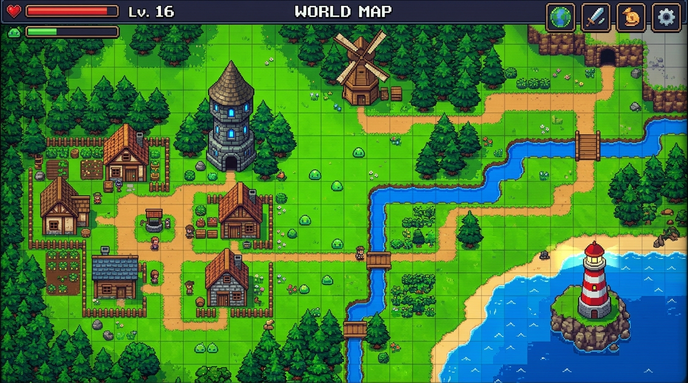
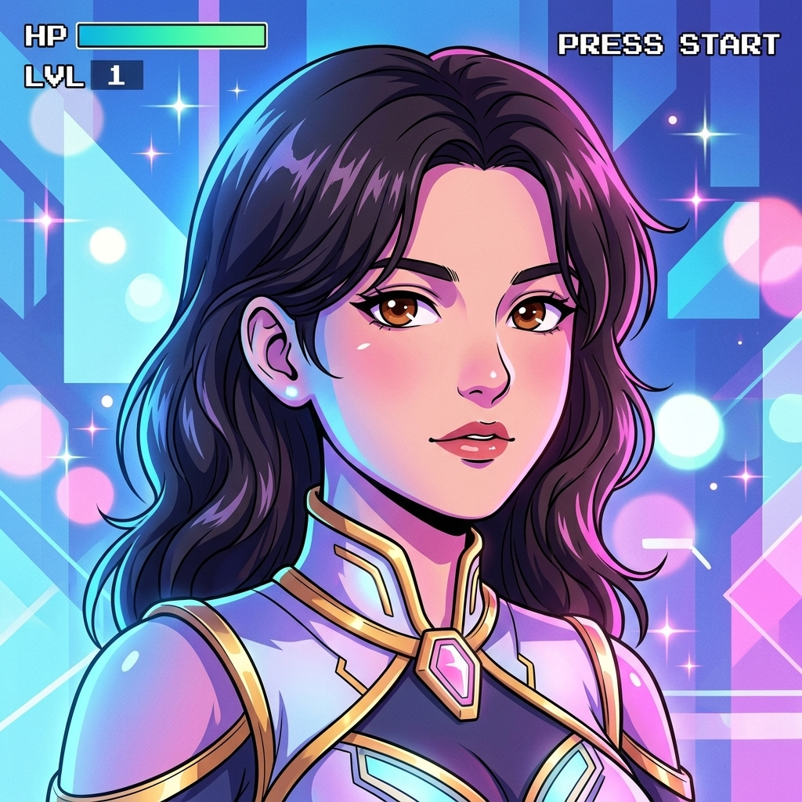

# InAmigos Foundation — Assessment Submission
## Task 1: Personal Profile Website (AI Based) 🌐

---

### 📌 Intern & Submission Details

| Field | Detail |
| :--- | :--- |
| **Intern Name** | Sara Dhoundiyal |
| **Role** | Web Development / AI Intern |
| **Organization** | InAmigos Foundation |
| **Task Title** | Assessment – Task 1: Personal Profile Website (AI Based) |
| **Submission Deadline** | 5th September 2026 | 7:00 PM |
| **Format** | Live Website Link & Documentation Package |
| **Primary Contact** | saradhoundiyal296@gmail.com | +91 7291019121 |
| **Location** | Delhi, India |

---

### 🔗 Submission Links

* **🌐 Live Portfolio Website Link**:  
  👉 **https://portfolio-dg92.vercel.app/**

* **🐙 GitHub Source Code Repository**:  
  👉 **https://github.com/Sasha-Mx/Portfolio**

* **💼 Published LinkedIn Post Link**:  
  👉 **[ PASTE YOUR PUBLISHED LINKEDIN POST LINK HERE ]**  
  *(e.g., https://www.linkedin.com/posts/sara-dhoundiyal_inamigosfoundation-...)*

---

### 📸 Project & Website Screenshots

#### 1. Live Hero Section & Atmospheric Engine


#### 2. Interactive Nintendo 3DS Dual-Screen Console


#### 3. 16-Bit RPG Adventure World Map & Player HUD


#### 4. Sara Dhoundiyal — Animated Gamified Character Avatar


#### 5. Project Glimpse: Mentra.AI (Career Roadmap & AI Mock Interview)
*Live Deployment: [aimentra-three.vercel.app](https://aimentra-three.vercel.app/)*  


#### 6. Project Glimpse: PawCare (Veterinary Health & Pet Care App)
*Live Deployment: [paw-care-zeta.vercel.app](https://paw-care-zeta.vercel.app)*  


#### 7. Project Glimpse: MinDOasis (Mental Wellness & Emotion Tracking)
*Live Deployment: [mindoasis-proto.vercel.app](https://mindoasis-proto.vercel.app)*  


#### 8. Project Glimpse: RouteIQ (Delhi Transit Replanner with GTFS)
*Live Deployment: [route-iq-delta.vercel.app](https://route-iq-delta.vercel.app)*  


#### 9. Project Glimpse: ArthSahay (Conversational AI Loan Guide • Tata Capital)
*Live Deployment: [arth-sahay-sasha-mxs-projects.vercel.app](https://arth-sahay-sasha-mxs-projects.vercel.app)*  


---

### 📱 LinkedIn Submission & Social Sharing Proof

> **Assessment Instruction**: *"Share your website on LinkedIn or any social media platform (Tag InAmigos Foundation & take a screenshot). Keep all related files, links, and screenshots saved in your Drive."*

#### LinkedIn Post Link:
`[ PASTE YOUR PUBLISHED LINKEDIN POST LINK HERE ]`

#### Screenshot of Published LinkedIn Post (Tagging @InAmigos Foundation):

```
+-----------------------------------------------------------------------+
|                                                                       |
|   [ 📸 PASTE / INSERT SCREENSHOT OF YOUR PUBLISHED LINKEDIN POST HERE ] |
|                                                                       |
|   Make sure the screenshot clearly shows:                             |
|   1. Your post text and live portfolio link (https://portfolio-dg92.vercel.app/) |
|   2. The @InAmigos Foundation tag                                     |
|   3. Your attached gamified portrait / website screenshot             |
|                                                                       |
+-----------------------------------------------------------------------+
```
