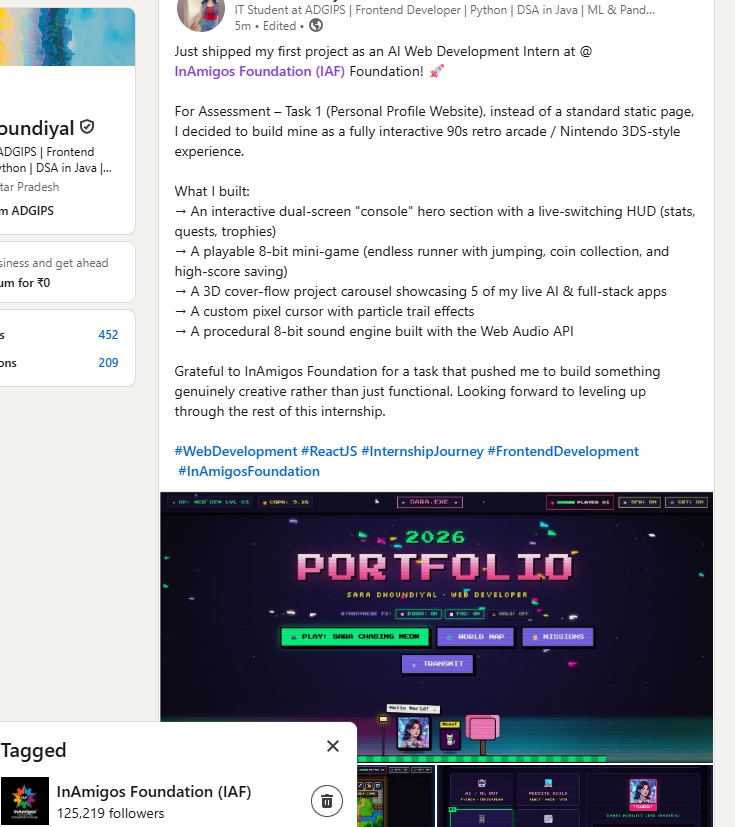

# InAmigos Foundation — Assessment Submission
## Task 1: Personal Profile Website (AI Based) 🌐

---

### 📌 Intern & Submission Details

| Field | Detail |
| :--- | :--- |
| **Intern Name** | Sara Dhoundiyal |
| **Role** | Web Development / AI Intern |
| **Organization** | InAmigos Foundation |
| **Task Title** | Assessment – Task 1: Personal Profile Website (AI Based) |
| **Submission Deadline** | 5th September 2026 \| 7:00 PM |
| **Format** | Live Website Link & Documentation Package |
| **Primary Contact** | saradhoundiyal296@gmail.com |
| **Location** | Delhi, India |

---

### 🔗 Submission Links

* **🌐 Live Portfolio Website Link**:  
  👉 **https://portfolio-dg92.vercel.app/**

* **🐙 GitHub Source Code Repository**:  
  👉 **https://github.com/Sasha-Mx/Portfolio**

* **💼 Published LinkedIn Post Link**:  
  👉 **https://lnkd.in/p/gkCRP8wX**

---

### 📸 Portfolio Application Screenshots

#### 1. Live Hero Section & Atmospheric Engine (Vercel Live)

#### 2. Interactive Nintendo 3DS Dual-Screen Hardware Console

#### 3. Nintendo 3DS Interactive Stats Matrix & OS Windows

#### 4. 16-Bit RPG Adventure Overworld Map & Player HUD

#### 5. "Choose Your Developer!" Arcade Fighter Select Cabinet

#### 6. Sara Dhoundiyal — Animated Gamified Character Avatar

---

### 📱 LinkedIn Submission & Social Sharing Proof

* **Published Post URL**: [https://lnkd.in/p/gkCRP8wX](https://lnkd.in/p/gkCRP8wX)  
* **Tagged Organization**: @InAmigos Foundation (IAF)

